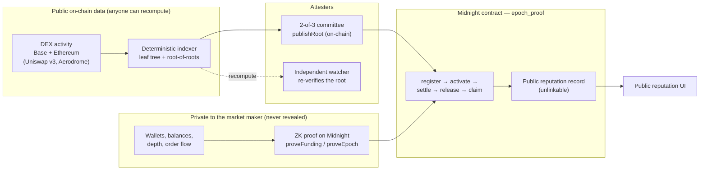

# mm-reputation

**A private reputation record for crypto market makers.** Prove you met your
commitments — depth, uptime, custody, fair trading — without handing over your
wallets, balances, or strategy. Built with zero-knowledge proofs on **Midnight**,
checked against a deterministic, public on-chain indexer that nobody can fake.

## 👀 For reviewers — start here

**No setup needed:**

- **See the product** — the public reputation profile a client/MM actually sees:
  **_[live URL — add after Vercel deploy]_** · _(until then: `pnpm --filter web dev` → `localhost:3000`)_
  Open a profile (`/mm/vega-mm`), its depth/uptime chart, and the one-page tear
  sheet (`/mm/vega-mm/tear-sheet`). This shows **what** the product is, in plain language.
- **Check it's really on Midnight** — the `epoch_proof` contract is deployed and
  verifiable on the public Preview testnet. Open the
  **[Midnight Explorer](https://midnightexplorer.com)**, switch the network selector
  to **Preview**, and paste the contract address:
  `48e2cfceccd0a7b771f5bb71337455f2df03540aadcaf0bc3687d310e52d9eb6` (all 11 circuits on chain).

**One command, if you have a terminal** (the strongest proof — it recomputes a real
on-chain epoch and checks it):

```sh
pnpm install && pnpm --filter @mmr/watcher test
```

It rebuilds the attested root from published data and **fails if any single metric is
changed by one unit** — i.e. the market maker cannot lie about what the chain recorded.

### Go deeper

| | |
|---|---|
| ▶️ **Demo walkthrough** | [`DEMO.md`](./DEMO.md) — every command and what it proves |
| 📄 **What's on Midnight** | [`specs/BUILT_ON_MIDNIGHT.md`](./specs/BUILT_ON_MIDNIGHT.md) — the ZK primitives, in action |
| 🚀 **Host the UI** | [`specs/DEPLOY_VERCEL.md`](./specs/DEPLOY_VERCEL.md) — one-click Vercel deploy (no env, runs on fixtures) |

> The UI shows **what** the product is and runs with zero setup. The terminal demos
> prove the **cryptography** underneath. A non-technical reviewer should open the UI;
> a technical one runs the verify command above.

---

## How it works



The market maker's books stay private (the `witness` side). The chain data, the
attested root, and the final record are public. A proof ties the two together:
it shows the private numbers met the terms, measured against data the MM cannot
forge — and the resulting reputation can't be traced back to any single client.

---

## What's delivered (real, not mocked)

- **One Compact contract, full lifecycle** — `register → postBond → activate →
  publishRoot → proveFunding → proveEpoch → settleEpoch → releaseEpoch →
  voidUnfunded → defaultEngagement → claim`.
- **All ten invariants (I1–I10) enforced in-circuit** — depth, uptime, custody
  floor, net-sell cap, outflow carry-forward, round-trip cap, settlement,
  identity-point, once-only claim — plus the **I8 attester-root registry** (2-of-3,
  on-chain) and the **funding-membership** proof. No invariant is trusted
  off-chain.
- **Real zero-knowledge keys** — `zkir` keygen for all 11 circuits on the final
  layout (`proveEpoch` k=20, `claim` k=19, `proveFunding` k=17, …).
- **123 known-answer tests passing** — they execute the *compiled* circuit through
  `@midnight-ntwrk/compact-runtime`; an honest witness passes and **every tampered
  witness reverts** (mutation-probed).
- **Deployed to Midnight's public Preview testnet** — batched deploy, **11/11
  circuits verified on chain**, `findDeployedContract()` attaches.
- **Full lifecycle runs live on a real Midnight node** — `register → activate →
  publishRoot ×2 → proveFunding` as real on-chain calls; the heavy/time-gated
  circuits verified by the test suite. See [`specs/LIVE_LOCAL_LIFECYCLE.md`](./specs/LIVE_LOCAL_LIFECYCLE.md).
- **Deterministic indexer + independent watcher** — a real Base epoch (BROOMY/WETH)
  indexed end to end; the watcher rebuilds the attested root from published data,
  and a one-unit change to any metric is caught.
- **Live Base _and_ Ethereum archive-RPC reader** — the real `ChainProvider` is wired
  behind the existing interface and drives the full pipeline against live archive RPC,
  building each epoch twice over independent publishers and asserting a byte-identical
  root that the independent watcher then recomputes. Both chains run live from this
  cloud session (proxy-aware transport, resumable RPC cache):
  **Base** (2026-10-21, BROOMY/WETH 0.3%) → root `0x5a3a6373…d04461`, matching the
  committed fixture; **Ethereum mainnet** (2026-11-10, a freshly-created Uniswap v3
  pool / USDT) → root `0xc4f5ae0e…2c34`, 2126 leaves, watcher-verified. Both are
  committed as offline KAT fixtures (`packages/watcher/fixtures/`).
- **Real data adapters** — IPFS publisher (Pinata v3) and Postgres repository
  (`@mmr/db`), both behind clean interfaces.
- **Daily indexer job** — `apps/worker` indexes each closed UTC day and stores the
  root. Production runs it on **Trigger.dev**; for this demo it runs on **GitHub
  Actions' scheduler** (`.github/workflows/daily-index.yml`).
- **Market-maker witness-capture tool** — `@mmr/witness`: the MM's local, private
  per-epoch witness store. Each epoch it runs the I1–I8 oracle over the MM's own
  committed wallets, chains the carry-forward (lifetime-budget) commitment from the
  previous epoch, and persists the record so the full set is in hand at claim time —
  resumable, in-order-enforced, with coverage reporting.
- **Portable attestation + client verifier** — `@mmr/attest`: an EAS-style typed,
  revocable, time-stamped epoch attestation and a verifier (plus CLI) a client runs
  themselves to re-derive the root from the published tree.
- **Public reputation UI** — landing, profile, and tear-sheet; `next build` passes.

## Scope & honest status (what's next)

This is a working protocol core, not yet a turnkey product. Clearly-scoped
integration work remains, and one item is an external ecosystem issue:

- **Live contract calls on public networks are currently blocked.** Deploys land
  on Preview, but *calls* from a registration-funded wallet are dropped /
  `NotNormalized` on the live ledger. We traced it end to end: a **byte-identical
  local node accepts the same calls**, so it is not our contract or client — it is
  isolated to the wallet's DUST and reported to Midnight. Full write-up and
  reproduction: [`specs/CALL_SUBMISSION_BLOCKER.md`](./specs/CALL_SUBMISSION_BLOCKER.md).
- **Witness capture — off-chain scope.** `@mmr/witness` captures per epoch and is wired
  to the live archive-RPC reader (`captureLiveEpoch` filters the pool index to the MM's
  committed wallets); what remains is extending capture to off-chain / CEX venues (zkTLS).
- **Real attester operations** — the on-chain 2-of-3 threshold is enforced; a live
  3-operator fleet with Jubjub-Schnorr signing is the operational piece.
- **Fee-sponsor** (DUST self-relay) and the live frontend API/DB path.

Nothing above is a hole in the core logic; it is production plumbing and one
external bug.

<sub>Deep dive: [`specs/`](./specs) holds the full spec-driven context repository,
including `progress_tracker.md` — the internal, dated build log of every decision and
design iteration.</sub>

---

## Layout

```
specs/           Spec-driven context repository (product + method) + runbooks
packages/
  merkle/        Leaf schema, indexed Merkle tree (depth 16), epoch root-of-roots   [tested]
  indexer/       Deterministic Base + Ethereum indexer (Uniswap v3, commitments)    [tested]
  prover/        Engagement model, witness assembly, I1-I10 reference oracle, CLI    [tested]
  protocol/      Settlement state machine + attester committee                      [tested]
  watcher/       Independent root recomputation + client verdict log                [tested]
  read-model/    Shared reputation read model + fixtures                            [tested]
  db/            Postgres (Prisma) profile repository (@mmr/db)                      [tested]
  contracts/     Compact 0.31.x contract (epoch_proof, I1-I10) + 123 KATs           [compiled, keyed, deployed]
  dapp/          Midnight deploy + interact (batched deploy, lifecycle)             [runs on a real node]
apps/
  web/           Public reputation profile + tear sheet + depth/uptime chart        [builds]
  api/           Read-model API for the UI's live backend path                      [TS]
  worker/        Daily indexer job (Trigger.dev in production; GitHub Actions for this demo) [tested]
```

## Develop

```sh
pnpm install
pnpm -r typecheck
pnpm -r test         # includes the 123 contract KATs where the toolchain is present
pnpm --filter web dev
```

Requires Node ≥ 22 and pnpm. The Compact circuits in `packages/contracts` are
compiled and keyed with the Midnight toolchain (not run in CI); see
[`specs/TESTNET_DEPLOY.md`](./specs/TESTNET_DEPLOY.md) for the deploy + interact flow
and [`specs/BUILT_ON_MIDNIGHT.md`](./specs/BUILT_ON_MIDNIGHT.md) for what each circuit
uses.

> Built spec-first. [`AGENTS.md`](./AGENTS.md) and the [`specs/`](./specs) context
> repository are the source of truth.
