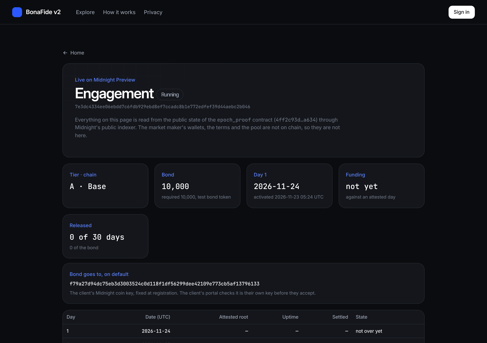
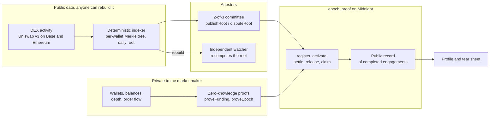

<p align="center"></p>

# mm-reputation

**A verifiable track record for crypto market makers. Built on Midnight.**

<p>
  <a href="https://github.com/ronniethedevv/mm-reputation/actions/workflows/ci.yml"></a>
  <a href="LICENSE"></a>
  
  
  
</p>

**[Live site](https://mm-reputation-web.vercel.app)** ·
**[The live engagement, read from the chain](https://mm-reputation-web.vercel.app/engagement/7e3dc4334ee06ebdd7c6fdb929ebd8ef7ccadc8b1e772edfef39d44aebc2b046)** ·
**[A market maker's profile](https://mm-reputation-web.vercel.app/mm/vega-mm)** ·
**[Tear sheet](https://mm-reputation-web.vercel.app/mm/vega-mm/tear-sheet)** ·
**[Demo guide](DEMO.md)** ·
**[Built on Midnight](specs/BUILT_ON_MIDNIGHT.md)** ·
**[Specifications](specs/README.md)**

Token projects hand market makers inventory, loans and fees, and then have to take their word for
the result. A market maker cannot prove it delivered without showing its wallets, balances and
strategy, which no serious firm will do. mm-reputation closes that gap. The market maker commits to
an engagement's wallets and terms, then proves each day, in zero knowledge, that its liquidity met
those terms: depth inside the agreed price band, uptime, custody of the client's tokens, capped
selling and no self-dealing volume. Every figure is checked against a public, deterministic index of
on-chain DEX activity that anyone can rebuild. The client sees each day's result, the public sees a
record of completed engagements, and nobody sees the wallets, the terms or the books.

**Contents:** [On Midnight](#on-midnights-preview-testnet) ·
[Why privacy is the requirement](#why-privacy-is-the-requirement) ·
[How it works](#how-it-works) · [What the proofs check](#what-the-proofs-check) ·
[What is private, what is public](#what-stays-private-what-is-public-and-why) ·
[Try it](#try-it) · [Tests](#tests) · [Scope and limits](#scope-and-limits) ·
[Repository layout](#repository-layout) · [Roadmap](#roadmap) · [License](#license)

## On Midnight's Preview testnet

The contract runs on Midnight's Preview network (ledger 9), with the verifier keys of all 12
circuits on chain.

| Contract | Address | Role |
|---|---|---|
| `epoch_proof` | `4ff2c93db78baabc96e66b58eb4890f2ab2d7a7fc3f8930b6a89395de7f9a634` | The protocol: registration, bond escrow, daily proofs, attested roots, settlement, claims |
| `test_bond_token` | `30cba5938199c82e9e4c06355d59797913d9641023582e7f8436ce673bd31b61` | A shielded test token for bonds. Preview's faucet issues only unshielded tNIGHT, and a bond is a shielded coin |

| Step | Transaction |
|---|---|
| Deploy wallet funded from the faucet; its tNIGHT registered to generate DUST for fees | `00bb9e0086039175d676bd93fdd5eb29af03d725e003181a36bcc126187ec8bcdd` |
| `test_bond_token` deployed | `008c244e594233cd11976466877ef0710cc49cef6f859299b421f434b37d865b21` |
| `epoch_proof` deployed with 7 circuits' keys (block 231,968) | `009fa9c6bc350c7fb12559f37b25f66f58ca34b5925e1bf7377942c31552700417` |
| Keys added for `settleEpoch`, `releaseEpoch`, `voidUnfunded`, `defaultEngagement` and `claim`, one maintenance transaction each | 5 transactions, listed in the record |

Every address and transaction id: [`packages/dapp/deployments/preview.json`](packages/dapp/deployments/preview.json).

**Why the deploy takes six transactions.** A deploy writes the whole contract state, verifier keys
included, and a Midnight block accepts 50,000 written bytes, of which one transaction may use about
65%. With all 12 keys, `epoch_proof`'s deploy writes more than that, so the node would refuse it. It
is deployed with 7 keys, and the other 5 are added by maintenance transactions signed with the
contract's maintenance key, following Midnight's batched-deploy runbook. The first deployment of
an earlier version (`2f663d74…c2b6`) and its sample engagement are kept in
[`preview-v1.json`](packages/dapp/deployments/preview-v1.json) and
[`preview-v1-lifecycle.json`](packages/dapp/deployments/preview-v1-lifecycle.json).

**Check it yourself, without a wallet:**

```bash
pnpm install
pnpm --filter @mmr/dapp check-deployment
```

The command reads the contract's state from Midnight's public Preview indexer, decodes it with the
ledger, and lists every circuit that has a verifier key on chain. If you build the contract first
(`pnpm --filter @mmr/contracts compact:build`, Compact 0.36.1, about 4 minutes), it also compares
each on-chain key with your build, byte for byte. All 12 match. Key generation is deterministic, so a
different source would produce different keys. Preview explorers:
[Midnight Explorer](https://preview.midnightexplorer.com/),
[Subscan](https://midnight-preview.subscan.io/),
[1AM](https://explorer.1am.xyz/?network=preview).

### The live engagement, on real Base data

Engagement `7e3dc433…b046` runs for 30 days on the VIRTUAL/USDC pool (Uniswap v3
on Base, `0x529d2863a1521d0b57db028168fde2e97120017c`). Day 1 is 24 November 2026.

**A demonstration on public wallets.** The committed wallets are three liquidity providers on that
pool, chosen from public data because they kept two-sided depth through October. We do not
control them and they do nothing for us. The terms are a retainer set so that no proof can fail on
these wallets' behaviour: no loan, and the outflow, net-selling and round-trip caps are wide open.
What is measured is depth of 250 USDC a side within 2% of the price, in 36 of 48 half-hours; each
day's uptime is recorded on chain. Every figure comes from Base, indexed daily.

| Step | Circuit | Block | Transaction | Proof and inclusion |
|---|---|---|---|---|
| Market maker receives 10,000 test bond tokens | `test_bond_token.mint` | 232,532 | `00e4245d…9da354bd` | 24.6 s |
| Register: wallet and terms commitments; tier A, Base, 10,000 bond | `register` | 232,537 | `00acfee7…4e2d3ee1` | 30.6 s |
| Bond held by the contract | `postBond` | 232,542 | `007dc77d…58b6dec8` | 29.2 s |
| Market maker starts the clock; day 1 is 24 Nov 2026 | `activate` | 232,546 | `00ca2e3e…dede1473` | 23.9 s |

Before day 1 we checked the terms against real data, with no transaction: the engagement's own
wallets, terms and salts, and 22 November as published by the daily indexer, run through the
compiled contract. The published day recomputed, all three wallets were in the pool, `proveEpoch`
accepted with uptime 48 of 48 (the terms need 36) and `proveFunding` accepted.

Funding is proven against 23 or 24 November once the daily indexer has published one of those days.
From then on the scheduled job attests each indexed day, proves it, settles it and releases its
share of the bond. Every transaction id:
[`packages/dapp/deployments/preview-lifecycle.json`](packages/dapp/deployments/preview-lifecycle.json).

Its public state, read from the contract through Midnight's public indexer on every visit:
[the live engagement page](https://mm-reputation-web.vercel.app/engagement/7e3dc4334ee06ebdd7c6fdb929ebd8ef7ccadc8b1e772edfef39d44aebc2b046).

<p align="center"></p>

### A second engagement, for the void path

Registered with the market maker's own commands (`pnpm --filter @mmr/dapp mm`) from its own sealed
file: tier C, a 2,500 bond, the same pool and terms, and never to be activated. Once its 72-hour
funding window has passed, `voidUnfunded` returns the bond to the market maker. That circuit has
so far run only in the tests.

| Step | Circuit | Block | Transaction | Proof and inclusion |
|---|---|---|---|---|
| Market maker receives 2,500 test bond tokens | `test_bond_token.mint` | 237,863 | `004fe95b…a22db8ca` | 26.5 s |
| Register: tier C, Base, 2,500 bond | `register` | 237,868 | `00920428…aa79a468` | 29.8 s |
| Bond held by the contract | `postBond` | 237,876 | `0002b4e9…4053d767` | 30.4 s |
| The bond goes back: never activated | `voidUnfunded` | from 26 Nov 2026, 14:18 UTC | | |

Engagement `c0d1c6ef…6e1a`. Every transaction id:
[`packages/dapp/deployments/preview-void-demo-lifecycle.json`](packages/dapp/deployments/preview-void-demo-lifecycle.json).

### Seven circuits, proven live on an earlier deployment

A sample engagement ran on the first deployment of an earlier version, as real, proven
transactions. It used the contract tests' sample day (two committed wallets, one pool), not real
trading data. That deployment is retired; it shows each step proving and landing on Preview, and
how long each takes.

| Step | Circuit | Block | Transaction | Proof and inclusion |
|---|---|---|---|---|
| Market maker receives 10,000 test bond tokens | `test_bond_token.mint` | 169,367 | `00135279…fa25c2a9` | 31.4 s |
| Register: wallet and terms commitments; tier A, Base, 10,000 bond | `register` | 169,372 | `0042d7d4…e91af71b` | 29.2 s |
| Bond held by the contract | `postBond` | 169,378 | `00686f12…eefbbe4b` | 35.8 s |
| Market maker starts the clock; day 1 is 19 Nov 2026 | `activate` | 169,382 | `00accded…8e32ddd0` | 23.9 s |
| Attester 1 votes for day 1's root | `publishRoot` | 169,386 | `00be895c…dcd6e4b8` | 23.8 s |
| Attester 2 votes; day 1's root is published | `publishRoot` | 169,390 | `002b5499…289a00a2` | 23.7 s |
| The loan reached the committed wallets | `proveFunding` | 169,397 | `006cdefd…4458d9ad` | 41.3 s |
| Day 1 met the terms: 48 of 48 buckets | `proveEpoch` | 169,413 | `00fd8507…5c6e4f5e` | 96.0 s |
| Day 2's root: attester 1 votes | `publishRoot` | 226,692 | `0088be1c…5f601139` | 23.9 s |
| Day 2's root: attester 2 votes; published | `publishRoot` | 226,696 | `00f54316…f6676168` | 24.1 s |
| Day 2 met the terms, outflow totals carried from day 1 | `proveEpoch` | 226,712 | `00a60d48…91ff208b` | 95.6 s |
| Day 2 settled | `settleEpoch` | 226,716 | `00f22da0…da3348c9` | 23.9 s |
| Day 3's root: attester 1 votes | `publishRoot` | 226,720 | `00e0dc68…0f8ef66a` | 22.4 s |
| Day 3's root: attester 2 votes; published | `publishRoot` | 226,724 | `002e5c57…359eae02` | 23.9 s |
| Day 3 met the terms, outflow totals carried from day 2 | `proveEpoch` | 226,737 | `00f31cec…dcb9e82b` | 78.6 s |
| Day 3 settled | `settleEpoch` | 226,741 | `00bcb910…d6885c03` | 23.7 s |

Engagement `4909ffd1…7e18` on that deployment. Every transaction id:
[`packages/dapp/deployments/preview-v1-lifecycle.json`](packages/dapp/deployments/preview-v1-lifecycle.json).

## Why privacy is the requirement

- **A market maker's wallets are its strategy.** Publishing them shows every position and invites
  front-running and copying.
- **Engagement terms are commercial secrets** for both sides: loan size, depth targets, selling
  allowance and fees.
- **Clients need to verify, not trust.** Today they get screenshots and self-reported dashboards.
- **A public record must be complete and uneditable,** or it is marketing.

Selective disclosure meets all four at once: the evidence is public, the inputs stay private, and a
proof binds one to the other. That is why this runs on Midnight.

## How it works

1. **Register.** The market maker and the client agree the terms off chain. The contract stores a
   commitment to the market maker's wallet set and a commitment to the terms, plus the public tier,
   chain, required bond and the client's Midnight key, which receives the bond on a default. The
   client saves that key on its own account, and its portal lets it accept only a registration
   that names it. Each committed trading wallet signs a message naming itself and this
   engagement (a signature, not a transaction), and the portal lets the client accept only when
   every wallet has signed: a market maker cannot take credit for liquidity it does not control.
   The market maker's agent creates the engagement file and proposes it from the market maker's
   own machine, so the trading wallets never reach a web page; the server receives only the two
   commitments and the terms sealed to the client. The engagement id is the hash of a secret only
   the market maker holds.
2. **Bond and activate.** The market maker posts a bond in the bond token, held by the contract, at
   least the tier's minimum (A 10,000, B 5,000, C 2,500). Only the market maker can start the clock,
   and only after the bond is in. Day 1 is the next UTC day. Before sending the loan, the client's
   portal finds the engagement on Midnight by the two commitments the client accepted and checks
   the rest against the terms it holds: the bond's beneficiary is the client's key, the tier, chain
   and bond are as agreed, the bond is held and the clock has started.
3. **Index and attest.** Each day, a deterministic indexer reads Uniswap v3 activity on Base and
   Ethereum from an archive node and builds a Merkle tree of per-wallet results, published to IPFS.
   A committee of three attesters puts the day's root on chain once two of them vote for it, each
   after rebuilding it from the published trees. Anyone can rebuild it the same way, and two
   committee members can dispute a bad one until the day's deadline (66 hours after it ends).
4. **Prove.** For each day, the market maker proves in zero knowledge that its committed wallets,
   opened against that day's published root, met the terms (`proveEpoch`). Once per engagement it
   proves that the client's loan reached those wallets (`proveFunding`).
5. **Settle and release.** A proven day is settled after it ends, before its deadline. At the
   deadline, when disputes have closed, its share of the bond goes back to the market maker and the
   day counts toward the claim. A disputed day is neutral: its share goes back, it never counts and
   it cannot default. A day neither settled nor disputed by its deadline defaults, and the whole
   remaining bond goes to the client.
6. **Claim.** When the engagement ends, the market maker claims it into its public profile with a
   nullifier: it counts once, cannot be removed, and the profile entry does not reveal which
   engagement it came from. A profile's record is read from the contract's per-tier counters by
   its profile id, which the market maker shares: [the live market maker's record](https://mm-reputation-web.vercel.app/record/609d764be4887f7618334da0365ad5814d1e581a851bd5ef1430d9ee051e566c)
   (empty until its first claim; the live engagement's full claim is possible from 26 December,
   18:00 UTC, when day 30 is credited).



## What the proofs check

Every check runs inside a circuit. Nothing is trusted off chain.

| Check | What it means | Circuit |
|---|---|---|
| Funding | The client's loan arrived in the committed wallets | `proveFunding` |
| Wallet set | The wallets proven are exactly the committed ones: sorted, none dropped, none swapped | `proveEpoch` |
| Every wallet accounted for | Each wallet opens one leaf of the day's tree, or proves it had no activity | `proveEpoch` |
| Custody | Client tokens held, plus proceeds valued at the floor price, never fall below the loan minus the allowed disposal | `proveEpoch` |
| Net selling | Swap selling stays within the agreed allowance over swap buying | `proveEpoch` |
| Outflows | Transfers out stay within budget across the whole engagement, carried from day to day as a salted commitment | `proveEpoch` |
| Uptime | A time bucket counts only if both bid and ask depth inside the band met the target | `proveEpoch` |
| Round trips | Self-cancelling buy and sell volume stays under a cap and never counts as volume | `proveEpoch` |
| Attested data | The day's root is the one the committee published for that chain and day, and it is not disputed | `proveEpoch`, `settleEpoch` |
| Terms | The terms proven are the registered ones | `proveEpoch`, `settleEpoch` |
| Record | Each finished engagement is claimed once; public counters only grow | `claim` |

The full statement of each invariant, and which circuit enforces it:
[`packages/contracts/INVARIANTS.md`](packages/contracts/INVARIANTS.md).

Before the engagement starts, the client checks the rest in its own browser, with nothing taken on
the market maker's word:

| Check | What it means | When |
|---|---|---|
| Terms | The terms and wallets the client received recompute both commitments | Before accepting |
| Wallet ownership | Every committed wallet signed a message naming itself, its chain and this engagement; a smart wallet's signature is checked on its chain | Before accepting |
| Beneficiary | The bond names the client's own Midnight key | Before accepting |
| The engagement on chain | Registered with the accepted commitments; tier, chain and bond as agreed; the bond held; the clock started | Before sending the loan |

Wallet ownership is checked off chain today. Ledger 9's secp256k1 support could move it into the
circuit.

## What stays private, what is public, and why

| What | On the ledger | Why |
|---|---|---|
| Market maker's wallets | A commitment only | Wallets reveal positions and strategy |
| Engagement terms (loan, depth band and target, selling allowance, floor price) | A commitment only | Commercial terms for both sides |
| Per-wallet balances, depth and order flow | Nothing. They are private inputs, opened against the public root inside the proof | The evidence is checked without being shown |
| A day's uptime result | Public, under the engagement id | The client sees each day's result |
| Engagement id | Public: the hash of the market maker's secret | Names the engagement without naming the market maker |
| Tier, chain, required bond, client's payout address | Public | The client checks them before accepting, and they set the bond rules |
| Bond | A shielded coin held by the contract; the poster's coin key is public | Custody is real and enforced by the contract |
| Daily roots and IPFS addresses of the trees | Public | Anyone can rebuild and check them |
| Committee members | Public ids, hashes of each member's secret | Members vote by proving they know the secret |
| Profile record | Public counters per profile and tier: completed engagements, days on target | The track record buyers read; claimed with a nullifier that does not reveal the engagement |

Every value that reaches the ledger passes an explicit `disclose()` (72 in the contract); the Compact
compiler rejects any other path from private data to public state.

## Try it

**On the live site, no install:** [mm-reputation-web.vercel.app](https://mm-reputation-web.vercel.app).
Browse market makers, open a profile, then export its tear sheet. The profiles there are sample data
and say so on the page; real records appear as engagements complete.

<p align="center"></p>

**Check the deployment:** `pnpm --filter @mmr/dapp check-deployment` (see
[On Midnight](#on-midnights-preview-testnet)).

**Rebuild an attested day and catch a lie:**

```bash
pnpm install
pnpm --filter @mmr/watcher test
```

The watcher rebuilds a day's root from published data for a real Base epoch and a real Ethereum
epoch, and fails if any single metric is changed by one unit.

**Run every test:**

```bash
pnpm install
pnpm -r typecheck
pnpm -r test
```

The contract's tests need the compiled contract: `pnpm --filter @mmr/contracts kat:build` (Compact
0.36.1, a few seconds). Database tests need `TEST_DATABASE_URL`. Node.js 22 or later and pnpm 10.

**As a market maker, from your own machine:** connect the agent with a token from your dashboard,
create the engagement file locally, have each trading wallet sign its ownership message, then
propose. The trading wallets stay on your machine.

```bash
pnpm --filter @mmr/agent agent connect --server https://mm-reputation-web.vercel.app --token <agent token>
pnpm --filter @mmr/agent agent create --client 0x… --pool 0x… --pair VIRTUAL/USDC --wallets 0x…,0x… \
  --terms terms.json --tier 1 --bond 10000 --out engagement.mmr.json
pnpm --filter @mmr/agent agent propose engagement.mmr.json --signatures engagement.mmr.json.ownership.json
```

Once the client accepts, the Midnight steps run on the same machine, with your own wallet's seed and
a local proof server, so no key or proof leaves it:

```bash
pnpm --filter @mmr/dapp proof-server                      # a local proof server (Docker)
export MM_SEED=… MMR_ENGAGEMENT_PASSPHRASE=…              # your Midnight wallet's seed; the file's passphrase
pnpm --filter @mmr/dapp mm register engagement.mmr.json   # then bond and activate
pnpm --filter @mmr/dapp mm run engagement.mmr.json        # daily: funding, then prove, settle, release
pnpm --filter @mmr/dapp mm claim engagement.mmr.json      # once, after the last release
```

**Deploy your own:**

```bash
pnpm --filter @mmr/contracts compact:build   # circuits and proving keys (about 4 minutes)
pnpm --filter @mmr/dapp register-dust        # after funding DEPLOY_SEED's address from the faucet
pnpm --filter @mmr/dapp run deploy           # bond token, then epoch_proof in batches
pnpm --filter @mmr/dapp engagement:new       # seal the engagement (MMR_POOL, MMR_WALLETS, MMR_TERMS)
pnpm --filter @mmr/dapp lifecycle            # attest indexed days; register and carry the engagement
pnpm --filter @mmr/dapp mm status [file]     # the market maker's own commands for an engagement file:
                                             # status, register, bond, activate, run, claim, void, profile
```

It needs a proof server 9.0.0 on port 6300 (`pnpm --filter @mmr/dapp proof-server`) and a
`DEPLOY_SEED` in `packages/dapp/.env`. [`DEMO.md`](DEMO.md) walks through every command and what it
proves.

## Tests

545 tests across 16 packages, all run in CI on every change (14 of them need Postgres, which CI
provides).

| Package | Tests | What they cover |
|---|---|---|
| `contracts` | 147 | The compiled circuits: an honest witness passes, every tampered witness reverts, the full lifecycle with real time windows, disputes and credited days, the committed pool |
| `indexer` | 159 | Chain readers (RPC, logs, multicall), price and tick math, per-wallet depth and flow, tree building, the anti-JIT rule, the published series, the IPFS publisher |
| `web` | 46 | Wallet sign-in and sessions, the engagement registry, engagement terms, the bond's beneficiary check, the client's check before funding, agent tokens |
| `prover`, `protocol` | 32 each | Witness assembly and a reference implementation of every invariant; the settlement state machine and the attester committee |
| `watcher` | 30 | Rebuilding attested roots from published data, including one real Base and one real Ethereum epoch |
| `merkle` | 29 | Leaf schema, indexed Merkle tree, root of roots |
| `dapp` | 4 | End to end without a network: a day built by the indexer is read back, recomputed and turned into a witness the compiled contract accepts; tampered data is refused; the market maker's claim inputs, read from the ledger, are accepted by the compiled claim |
| Eight more | 66 | Read model, engagement files and wallet ownership, witness capture, attestations, the daily job, the database, the agent (creating and proposing an engagement), the tear sheet |

CI installs the Compact compiler pinned by checksum, compiles both contracts, typechecks every
package and runs every test against the compiled circuits; a missing build fails the run
([`.github/workflows/ci.yml`](.github/workflows/ci.yml)).

## Scope and limits

- **The live run has just started.** The engagement is registered, bonded and activated; its first
  day is 24 November. The daily indexer completed its first real day on GitHub Actions on
  23 November: 22 November, the day before registration, as a test (root `0xbe1c4e6b…c908`); the
  engagement's own days start with 23 November. The scheduled lifecycle job
  (attest, prove, settle, release) is tested end to end offline and first ran on 23 November,
  with no day due yet. A claim
  needs all 30 days, so it cannot run on chain before the engagement ends; every circuit, `claim`
  included, runs in the tests.
- **RPC plan.** Logs come from a free public endpoint (publicnode) in 10,000-block requests, about
  44 for a Base day; blocks, state and receipts come from a free Alchemy key, whose log requests
  span only 10 blocks (43,200 for a day). Before switching we compared 22 November: 65,511 logs,
  identical to an independent provider's full-day scan and to 200 sampled windows from Alchemy.
  Indexing that day on GitHub Actions took 62 minutes, 47 of them a one-time scan of every Uniswap
  v3 position on Base; logs and receipts took 72 seconds. The public endpoint keeps about two weeks of
  logs, so an older backfill needs a paid plan. Because logs and state come from different
  providers, every run checks that each address's balance change, read from Alchemy, is exactly
  explained by the transfers in the logs; a missing log stops the day. On 22 November all 1,849
  addresses that moved VIRTUAL passed. The demo indexes only the engagement's pool.
- **One operator holds the three attester keys** in this deployment, derived from one seed, and
  the daily job casts two of the three votes. In production each attester is a separate party.
- **The market maker's own commands** (`mm`, also a manual workflow) run every market-maker step
  on the market maker's machine, with its own seed (`MM_SEED`) and a local proof server:
  registration, bond, activation, the daily funding, proof, settlement and release, the claim and
  the void. In this demo one seed holds every key (market maker, client and the three attesters),
  and the scheduled job carries the live engagement. The claim is tested against the compiled
  circuit; on chain it is possible once days are credited, and the live engagement's full claim
  from 26 December.
- **Venues:** Uniswap v3 on Base and Ethereum. Aerodrome on Base is next. Centralized exchanges are
  out of scope: proving off-chain fills needs zkTLS.
- **The live engagement has no ownership signatures:** it was registered by script on three public
  wallets we do not control, as a demonstration. Through the app, a client cannot accept an
  engagement unless every committed wallet has signed for it.
- **Linkability:** the bond records the coin key of the wallet that posted it, so engagements bonded
  from the same wallet can be linked. Claims are not yet batched, so a claim's timing can hint at
  which engagement just ended.
- **Spread at a stated size** needs the full liquidity curve and is not proven.
- **The daily indexer** is built to run on Trigger.dev in production; for this demo it runs on
  GitHub Actions' scheduler ([`.github/workflows/daily-index.yml`](.github/workflows/daily-index.yml)).
- **Fees:** the market maker pays its own DUST; there is no fee sponsor yet.

## Repository layout

| Path | What |
|---|---|
| [`packages/contracts/`](packages/contracts) | `epoch_proof.compact` (12 circuits), `test_bond_token.compact`, and the tests that run the compiled circuits |
| [`packages/dapp/`](packages/dapp) | Preview deploy: headless wallet, DUST registration, batched deploy, deployment check; the scheduled lifecycle job and the market maker's `mm` commands |
| [`packages/indexer/`](packages/indexer) | Deterministic indexer for Base and Ethereum: chain readers, per-wallet trees, IPFS publisher |
| [`packages/merkle/`](packages/merkle) | Leaf schema, indexed Merkle tree, root of roots |
| [`packages/prover/`](packages/prover) | Engagement model, witness assembly, reference implementation of every invariant |
| [`packages/protocol/`](packages/protocol) | Settlement state machine and attester committee |
| [`packages/watcher/`](packages/watcher) | Independent root recomputation and the client's verdict log |
| [`packages/witness/`](packages/witness) | The market maker's local, private store of daily witnesses |
| [`packages/attest/`](packages/attest) | Portable epoch attestations and a verifier a client runs itself |
| [`packages/engagement-file/`](packages/engagement-file) | The encrypted engagement file shared between market maker and client |
| [`apps/web/`](apps/web) | Public profiles, tear sheets, market maker and client dashboards; the live engagement and track record pages, read from the contract |
| [`apps/worker/`](apps/worker) | The daily indexer job |
| [`specs/`](specs) | Architecture, design decisions, invariants and runbooks ([index](specs/README.md)) |

## Roadmap

- **This wave (first submission), done:** the contract on ledger 9 with every invariant enforced in
  a circuit, deployed to Preview with all 12 circuits; seven circuits proven on Preview in a sample
  engagement on an earlier deployment; the deterministic indexer and independent watcher; the
  attesters' recompute-then-vote job and the market maker's proofs from published data, tested
  end to end offline; a live engagement page read from the contract; the public profile, tear sheet
  and dashboards.
- **This wave, in progress:** the daily indexer's first real day and the engagement on the VIRTUAL/USDC
  pool on Base, carried forward by the scheduled job.
- **Next:** the engagement's 30 days, then the claim into a public profile read from the
  contract's per-tier counters; three independent attester operators; Aerodrome on Base; weekly claim batching; a DUST
  fee sponsor so a market maker needs no NIGHT of its own.

## License

Apache-2.0 ([LICENSE](LICENSE)).

Built for the Midnight Buildathon on Midnight's tools: the Compact compiler, `compact-runtime`,
Midnight.js, the wallet SDK and the proof server, running against Midnight's public Preview node and
indexer. mm-reputation is independent and not endorsed by the Midnight Foundation.
