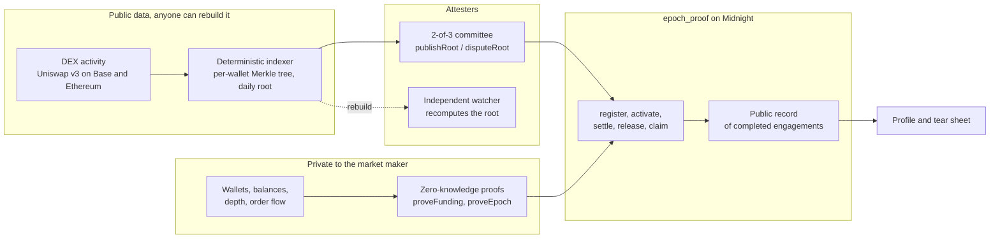
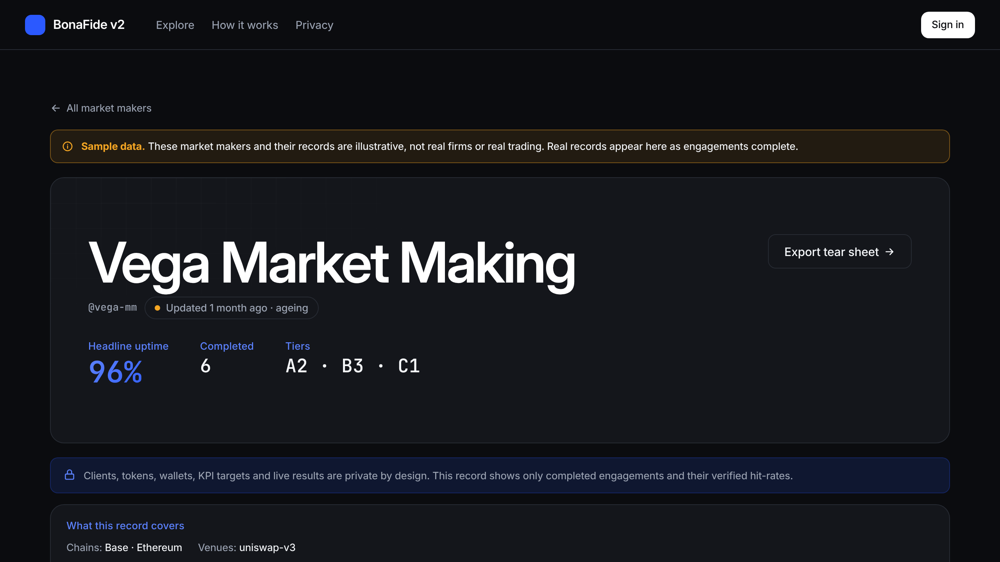

<p align="center"></p>

# mm-reputation

**A verifiable track record for crypto market makers. Built on Midnight.**

<p>
  <a href="https://github.com/ronniethedevv/mm-reputation/actions/workflows/ci.yml"></a>
  <a href="LICENSE"></a>
  
  
  
</p>

**[Live site](https://mm-reputation-web.vercel.app)** ·
**[A market maker's profile](https://mm-reputation-web.vercel.app/mm/vega-mm)** ·
**[Tear sheet](https://mm-reputation-web.vercel.app/mm/vega-mm/tear-sheet)** ·
**[Demo guide](DEMO.md)** ·
**[Built on Midnight](specs/BUILT_ON_MIDNIGHT.md)** ·
**[Specifications](specs/README.md)**

Token projects hand market makers inventory, loans and fees, and then have to take their word for
the result. A market maker cannot prove it delivered without showing its wallets, balances and
strategy, which no serious firm will do. mm-reputation closes that gap. The market maker commits to
an engagement's wallets and terms, then proves each day, in zero knowledge, that its liquidity met
those terms: depth inside the agreed price band, uptime, custody of the client's tokens, capped
selling and no self-dealing volume. Every figure is checked against a public, deterministic index of
on-chain DEX activity that anyone can rebuild. The client sees each day's result, the public sees a
record of completed engagements, and nobody sees the wallets, the terms or the books.

**Contents:** [On Midnight](#on-midnights-preview-testnet) ·
[Why privacy is the requirement](#why-privacy-is-the-requirement) ·
[How it works](#how-it-works) · [What the proofs check](#what-the-proofs-check) ·
[What is private, what is public](#what-stays-private-what-is-public-and-why) ·
[Try it](#try-it) · [Tests](#tests) · [Scope and limits](#scope-and-limits) ·
[Repository layout](#repository-layout) · [Roadmap](#roadmap) · [License](#license)

## On Midnight's Preview testnet

The contract runs on Midnight's Preview network (ledger 9), with the verifier keys of all 12
circuits on chain.

| Contract | Address | Role |
|---|---|---|
| `epoch_proof` | `2f663d748df2a50c02d74ebfdcc367361a39df01fbb03dd29b9a5c0d3e13c2b6` | The protocol: registration, bond escrow, daily proofs, attested roots, settlement, claims |
| `test_bond_token` | `30cba5938199c82e9e4c06355d59797913d9641023582e7f8436ce673bd31b61` | A shielded test token for bonds. Preview's faucet issues only unshielded tNIGHT, and a bond is a shielded coin |

| Step | Transaction |
|---|---|
| Deploy wallet funded from the faucet; its tNIGHT registered to generate DUST for fees | `00bb9e0086039175d676bd93fdd5eb29af03d725e003181a36bcc126187ec8bcdd` |
| `test_bond_token` deployed | `008c244e594233cd11976466877ef0710cc49cef6f859299b421f434b37d865b21` |
| `epoch_proof` deployed with 7 circuits' keys (block 168,424) | `005730daadad9179da8db83eb704a37f8f1f0401677c3f62d9faa8b89920e98f1e` |
| Keys added for `settleEpoch`, `releaseEpoch`, `voidUnfunded`, `defaultEngagement` and `claim`, one maintenance transaction each | 5 transactions, listed in the record |

Every address and transaction id: [`packages/dapp/deployments/preview.json`](packages/dapp/deployments/preview.json).

**Why the deploy takes six transactions.** A deploy writes the whole contract state, verifier keys
included, and a Midnight block accepts 50,000 written bytes, of which one transaction may use about
65%. With all 12 keys, `epoch_proof`'s deploy writes 39,464 bytes (79% of a block), so the node
would refuse it. It is deployed with 7 keys (27,058 bytes, 54%), and the other 5 are added by
maintenance transactions signed with the contract's maintenance key, following Midnight's
batched-deploy runbook.

**Check it yourself, without a wallet:**

```bash
pnpm install
pnpm --filter @mmr/dapp check-deployment
```

The command reads the contract's state from Midnight's public Preview indexer, decodes it with the
ledger, and lists every circuit that has a verifier key on chain. If you build the contract first
(`pnpm --filter @mmr/contracts compact:build`, Compact 0.36.1, about 4 minutes), it also compares
each on-chain key with your build, byte for byte. All 12 match. Key generation is deterministic, so a
different source would produce different keys. Preview explorers:
[Midnight Explorer](https://preview.midnightexplorer.com/),
[Subscan](https://midnight-preview.subscan.io/),
[1AM](https://explorer.1am.xyz/?network=preview).

### A sample engagement, live on Preview

One engagement runs through the deployed contract as real, proven transactions. It uses the
contract tests' sample day (two committed wallets, one pool), not real trading data, because an
engagement's day 1 is always the day after activation.

| Step | Circuit | Block | Transaction | Proof and inclusion |
|---|---|---|---|---|
| Market maker receives 10,000 test bond tokens | `test_bond_token.mint` | 169,367 | `00135279…fa25c2a9` | 31.4 s |
| Register: wallet and terms commitments; tier A, Base, 10,000 bond | `register` | 169,372 | `0042d7d4…e91af71b` | 29.2 s |
| Bond held by the contract | `postBond` | 169,378 | `00686f12…eefbbe4b` | 35.8 s |
| Market maker starts the clock; day 1 is 19 Nov 2026 | `activate` | 169,382 | `00accded…8e32ddd0` | 23.9 s |
| Attester 1 votes for day 1's root | `publishRoot` | 169,386 | `00be895c…dcd6e4b8` | 23.8 s |
| Attester 2 votes; day 1's root is published | `publishRoot` | 169,390 | `002b5499…289a00a2` | 23.7 s |
| The loan reached the committed wallets | `proveFunding` | 169,397 | `006cdefd…4458d9ad` | 41.3 s |
| Day 1 met the terms: 48 of 48 buckets | `proveEpoch` | 169,413 | `00fd8507…5c6e4f5e` | 96.0 s |
| Day 2's root: attester 1 votes | `publishRoot` | 226,692 | `0088be1c…5f601139` | 23.9 s |
| Day 2's root: attester 2 votes; published | `publishRoot` | 226,696 | `00f54316…f6676168` | 24.1 s |
| Day 2 met the terms, outflow totals carried from day 1 | `proveEpoch` | 226,712 | `00a60d48…91ff208b` | 95.6 s |
| Day 2 settled; its 12-hour challenge window starts | `settleEpoch` | 226,716 | `00f22da0…da3348c9` | 23.9 s |
| Day 3's root: attester 1 votes | `publishRoot` | 226,720 | `00e0dc68…0f8ef66a` | 22.4 s |
| Day 3's root: attester 2 votes; published | `publishRoot` | 226,724 | `002e5c57…359eae02` | 23.9 s |
| Day 3 met the terms, outflow totals carried from day 2 | `proveEpoch` | 226,737 | `00f31cec…dcb9e82b` | 78.6 s |
| Day 3 settled | `settleEpoch` | 226,741 | `00bcb910…d6885c03` | 23.7 s |

Engagement `4909ffd1f91c856448427eb6596cb574858c58448c4a802f92ffa97779c97e18`. Days 2 and 3 are proven
and settled; their shares of the bond are released after the 12-hour challenge window. Day 1 is
proven but was not settled inside its window (the run due on 20 Nov did not start), so under the
contract's rules day 1 is now defaultable: anyone may call `defaultEngagement`, which sends the bond
to the client. A day's settlement belongs in a scheduled job, not a manual run.
Every transaction id: [`packages/dapp/deployments/preview-lifecycle.json`](packages/dapp/deployments/preview-lifecycle.json).
Run it again, or carry it forward, with `pnpm --filter @mmr/dapp lifecycle`: each step reads the
contract's state first and is skipped if it already landed.

## Why privacy is the requirement

- **A market maker's wallets are its strategy.** Publishing them shows every position and invites
  front-running and copying.
- **Engagement terms are commercial secrets** for both sides: loan size, depth targets, selling
  allowance and fees.
- **Clients need to verify, not trust.** Today they get screenshots and self-reported dashboards.
- **A public record must be complete and uneditable,** or it is marketing.

Selective disclosure meets all four at once: the evidence is public, the inputs stay private, and a
proof binds one to the other. That is why this runs on Midnight.

## How it works

1. **Register.** The market maker and the client agree the terms off chain. The contract stores a
   commitment to the market maker's wallet set and a commitment to the terms, plus the public tier,
   chain, required bond and the client's address for a forfeited bond. The engagement id is the hash
   of a secret only the market maker holds.
2. **Bond and activate.** The market maker posts a bond in the bond token, held by the contract, at
   least the tier's minimum (A 10,000, B 5,000, C 2,500). Only the market maker can start the clock,
   and only after the bond is in. Day 1 is the next UTC day.
3. **Index and attest.** Each day, a deterministic indexer reads Uniswap v3 activity on Base and
   Ethereum from an archive node and builds a Merkle tree of per-wallet results, published to IPFS.
   A committee of three attesters puts the day's root on chain once two of them vote for it. Anyone
   can rebuild the root from the published tree, and two committee members can dispute a bad one,
   which freezes everything that depends on it.
4. **Prove.** For each day, the market maker proves in zero knowledge that its committed wallets,
   opened against that day's published root, met the terms (`proveEpoch`). Once per engagement it
   proves that the client's loan reached those wallets (`proveFunding`).
5. **Settle and release.** A proven day is settled after it ends. After a 12-hour challenge window,
   that day's share of the bond goes back to the market maker. A day left unproven past its
   deadline defaults, and the whole remaining bond goes to the client.
6. **Claim.** When the engagement ends, the market maker claims it into its public profile with a
   nullifier: it counts once, cannot be removed, and the profile entry does not reveal which
   engagement it came from.



## What the proofs check

Every check runs inside a circuit. Nothing is trusted off chain.

| Check | What it means | Circuit |
|---|---|---|
| Funding | The client's loan arrived in the committed wallets | `proveFunding` |
| Wallet set | The wallets proven are exactly the committed ones: sorted, none dropped, none swapped | `proveEpoch` |
| Every wallet accounted for | Each wallet opens one leaf of the day's tree, or proves it had no activity | `proveEpoch` |
| Custody | Client tokens held, plus proceeds valued at the floor price, never fall below the loan minus the allowed disposal | `proveEpoch` |
| Net selling | Swap selling stays within the agreed allowance over swap buying | `proveEpoch` |
| Outflows | Transfers out stay within budget across the whole engagement, carried from day to day as a salted commitment | `proveEpoch` |
| Uptime | A time bucket counts only if both bid and ask depth inside the band met the target | `proveEpoch` |
| Round trips | Self-cancelling buy and sell volume stays under a cap and never counts as volume | `proveEpoch` |
| Attested data | The day's root is the one the committee published for that chain and day, and it is not disputed | `proveEpoch`, `settleEpoch` |
| Terms | The terms proven are the registered ones | `proveEpoch`, `settleEpoch` |
| Record | Each finished engagement is claimed once; public counters only grow | `claim` |

The full statement of each invariant, and which circuit enforces it:
[`packages/contracts/INVARIANTS.md`](packages/contracts/INVARIANTS.md).

## What stays private, what is public, and why

| What | On the ledger | Why |
|---|---|---|
| Market maker's wallets | A commitment only | Wallets reveal positions and strategy |
| Engagement terms (loan, depth band and target, selling allowance, floor price) | A commitment only | Commercial terms for both sides |
| Per-wallet balances, depth and order flow | Nothing. They are private inputs, opened against the public root inside the proof | The evidence is checked without being shown |
| A day's uptime result | Public, under the engagement id | The client sees each day's result |
| Engagement id | Public: the hash of the market maker's secret | Names the engagement without naming the market maker |
| Tier, chain, required bond, client's payout address | Public | The client checks them before accepting, and they set the bond rules |
| Bond | A shielded coin held by the contract; the poster's coin key is public | Custody is real and enforced by the contract |
| Daily roots and IPFS addresses of the trees | Public | Anyone can rebuild and check them |
| Committee members | Public ids, hashes of each member's secret | Members vote by proving they know the secret |
| Profile record | Public counters per profile and tier: completed engagements, days on target | The track record buyers read; claimed with a nullifier that does not reveal the engagement |

Every value that reaches the ledger passes an explicit `disclose()` (72 in the contract); the Compact
compiler rejects any other path from private data to public state.

## Try it

**On the live site, no install:** [mm-reputation-web.vercel.app](https://mm-reputation-web.vercel.app).
Browse market makers, open a profile, then export its tear sheet. The profiles there are sample data
and say so on the page; real records appear as engagements complete.

<p align="center"></p>

**Check the deployment:** `pnpm --filter @mmr/dapp check-deployment` (see
[On Midnight](#on-midnights-preview-testnet)).

**Rebuild an attested day and catch a lie:**

```bash
pnpm install
pnpm --filter @mmr/watcher test
```

The watcher rebuilds a day's root from published data for a real Base epoch and a real Ethereum
epoch, and fails if any single metric is changed by one unit.

**Run every test:**

```bash
pnpm install
pnpm -r typecheck
pnpm -r test
```

The contract's tests need the compiled contract: `pnpm --filter @mmr/contracts kat:build` (Compact
0.36.1, a few seconds). Database tests need `TEST_DATABASE_URL`. Node.js 22 or later and pnpm 10.

**Deploy your own:**

```bash
pnpm --filter @mmr/contracts compact:build   # circuits and proving keys (about 4 minutes)
pnpm --filter @mmr/dapp register-dust        # after funding DEPLOY_SEED's address from the faucet
pnpm --filter @mmr/dapp deploy               # bond token, then epoch_proof in batches
pnpm --filter @mmr/dapp lifecycle            # the sample engagement, as far as the clock allows
```

It needs a proof server 9.0.0 on port 6300 (`pnpm --filter @mmr/dapp proof-server`) and a
`DEPLOY_SEED` in `packages/dapp/.env`. [`DEMO.md`](DEMO.md) walks through every command and what it
proves.

## Tests

509 tests across 16 packages, all run in CI on every change.

| Package | Tests | What they cover |
|---|---|---|
| `contracts` | 135 | The compiled circuits: an honest witness passes, every tampered witness reverts, the full lifecycle with real time windows |
| `indexer` | 152 | Chain readers (RPC, logs, multicall), price and tick math, per-wallet depth and flow, tree building, the anti-JIT rule, the IPFS publisher |
| `web` | 38 | Wallet sign-in and sessions, the engagement registry, engagement terms, agent tokens |
| `prover`, `protocol` | 32 each | Witness assembly and a reference implementation of every invariant; the settlement state machine |
| `watcher` | 30 | Rebuilding attested roots from published data, including one real Base and one real Ethereum epoch |
| `merkle` | 29 | Leaf schema, indexed Merkle tree, root of roots |
| Nine more | 61 | Read model, engagement files, witness capture, attestations, the daily job, the database, the API, the agent, the tear sheet |

CI installs the Compact compiler pinned by checksum, compiles both contracts, typechecks every
package and runs every test against the compiled circuits; a missing build fails the run
([`.github/workflows/ci.yml`](.github/workflows/ci.yml)).

## Scope and limits

- **The lifecycle on Preview is in progress.** On Preview so far: the deploy, its maintenance
  updates, and a sample engagement with three days proven and two settled; the releases follow
  their challenge windows. Day 1 missed its settlement window and is defaultable. A claim needs all
  30 days, so it has not run on chain; every circuit, `claim` included, runs in the tests.
- **One operator holds the three attester keys** in this deployment, derived from one seed. In
  production each attester is a separate party; the job that casts their daily votes is next.
- **Venues:** Uniswap v3 on Base and Ethereum. Aerodrome on Base is next. Centralized exchanges are
  out of scope: proving off-chain fills needs zkTLS.
- **Linkability:** the bond records the coin key of the wallet that posted it, so engagements bonded
  from the same wallet can be linked. Claims are not yet batched, so a claim's timing can hint at
  which engagement just ended.
- **Spread at a stated size** needs the full liquidity curve and is not proven.
- **The daily indexer** runs on Trigger.dev in production; for this demo it runs on GitHub Actions'
  scheduler ([`.github/workflows/daily-index.yml`](.github/workflows/daily-index.yml)).
- **Fees:** the market maker pays its own DUST; there is no fee sponsor yet.

## Repository layout

| Path | What |
|---|---|
| [`packages/contracts/`](packages/contracts) | `epoch_proof.compact` (12 circuits), `test_bond_token.compact`, and the tests that run the compiled circuits |
| [`packages/dapp/`](packages/dapp) | Preview deploy: headless wallet, DUST registration, batched deploy, deployment check |
| [`packages/indexer/`](packages/indexer) | Deterministic indexer for Base and Ethereum: chain readers, per-wallet trees, IPFS publisher |
| [`packages/merkle/`](packages/merkle) | Leaf schema, indexed Merkle tree, root of roots |
| [`packages/prover/`](packages/prover) | Engagement model, witness assembly, reference implementation of every invariant |
| [`packages/protocol/`](packages/protocol) | Settlement state machine and attester committee |
| [`packages/watcher/`](packages/watcher) | Independent root recomputation and the client's verdict log |
| [`packages/witness/`](packages/witness) | The market maker's local, private store of daily witnesses |
| [`packages/attest/`](packages/attest) | Portable epoch attestations and a verifier a client runs itself |
| [`packages/engagement-file/`](packages/engagement-file) | The encrypted engagement file shared between market maker and client |
| [`apps/web/`](apps/web) | Public profiles, tear sheets, market maker and client dashboards |
| [`apps/worker/`](apps/worker) | The daily indexer job |
| [`specs/`](specs) | Architecture, design decisions, invariants and runbooks ([index](specs/README.md)) |

## Roadmap

- **This wave (first submission):** the contract on ledger 9 with every invariant enforced in a
  circuit; deployed to Preview with all 12 circuits; a sample engagement on Preview with three days
  proven and two settled; the deterministic indexer and independent watcher on real Base and
  Ethereum data; the daily indexer job; the public profile, tear sheet and
  dashboards.
- **Next:** settlement and release on Preview, then a claim after the 30 days; three independent attester
  operators casting daily votes; Aerodrome on Base; weekly claim batching; a DUST fee sponsor so a
  market maker needs no NIGHT of its own.

## License

Apache-2.0 ([LICENSE](LICENSE)).

Built for the Midnight Buildathon on Midnight's tools: the Compact compiler, `compact-runtime`,
Midnight.js, the wallet SDK and the proof server, running against Midnight's public Preview node and
indexer. mm-reputation is independent and not endorsed by the Midnight Foundation.
