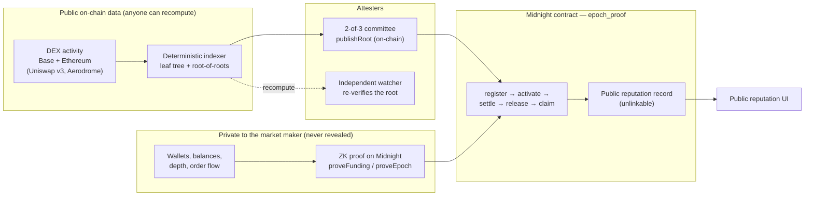

# mm-reputation

**A private reputation record for crypto market makers.** Prove you met your
commitments — depth, uptime, custody, fair trading — without handing over your
wallets, balances, or strategy. Built with zero-knowledge proofs on **Midnight**,
checked against a deterministic, public on-chain indexer that nobody can fake.

### Explore

| | |
|---|---|
| ▶️ **Demo walkthrough** | [`DEMO.md`](./DEMO.md) — what to run and what it proves |
| 📄 **What's on Midnight** | [`specs/BUILT_ON_MIDNIGHT.md`](./specs/BUILT_ON_MIDNIGHT.md) — the ZK primitives, in action |
| 🔍 **Verify it yourself** | `pnpm --filter @mmr/watcher test` — independently recomputes and checks a real on-chain epoch root |
| 🖥️ **Run the UI** | `pnpm --filter web dev` → `localhost:3000` — the public reputation profile |
| ⛓️ **Live on Midnight Preview** | `epoch_proof` deployed at `48e2cfceccd0a7b771f5bb71337455f2df03540aadcaf0bc3687d310e52d9eb6` (all 11 circuits on chain) |

---

## How it works



The market maker's books stay private (the `witness` side). The chain data, the
attested root, and the final record are public. A proof ties the two together:
it shows the private numbers met the terms, measured against data the MM cannot
forge — and the resulting reputation can't be traced back to any single client.

---

## What's delivered (real, not mocked)

- **One Compact contract, full lifecycle** — `register → postBond → activate →
  publishRoot → proveFunding → proveEpoch → settleEpoch → releaseEpoch →
  voidUnfunded → defaultEngagement → claim`.
- **All ten invariants (I1–I10) enforced in-circuit** — depth, uptime, custody
  floor, net-sell cap, outflow carry-forward, round-trip cap, settlement,
  identity-point, once-only claim — plus the **I8 attester-root registry** (2-of-3,
  on-chain) and the **funding-membership** proof. No invariant is trusted
  off-chain.
- **Real zero-knowledge keys** — `zkir` keygen for all 11 circuits on the final
  layout (`proveEpoch` k=20, `claim` k=19, `proveFunding` k=17, …).
- **123 known-answer tests passing** — they execute the *compiled* circuit through
  `@midnight-ntwrk/compact-runtime`; an honest witness passes and **every tampered
  witness reverts** (mutation-probed).
- **Deployed to Midnight's public Preview testnet** — batched deploy, **11/11
  circuits verified on chain**, `findDeployedContract()` attaches.
- **Full lifecycle runs live on a real Midnight node** — `register → activate →
  publishRoot ×2 → proveFunding` as real on-chain calls; the heavy/time-gated
  circuits verified by the test suite. See [`specs/LIVE_LOCAL_LIFECYCLE.md`](./specs/LIVE_LOCAL_LIFECYCLE.md).
- **Deterministic indexer + independent watcher** — a real Base epoch (BROOMY/WETH)
  indexed end to end; the watcher rebuilds the attested root from published data,
  and a one-unit change to any metric is caught.
- **Real data adapters** — IPFS publisher (Pinata v3) and Postgres repository
  (`@mmr/db`), both behind clean interfaces.
- **Public reputation UI** — landing, profile, and tear-sheet; `next build` passes.

## Scope & honest status (what's next)

This is a working protocol core, not yet a turnkey product. Clearly-scoped
integration work remains, and one item is an external ecosystem issue:

- **Live contract calls on public networks are currently blocked.** Deploys land
  on Preview, but *calls* from a registration-funded wallet are dropped /
  `NotNormalized` on the live ledger. We traced it end to end: a **byte-identical
  local node accepts the same calls**, so it is not our contract or client — it is
  isolated to the wallet's DUST and reported to Midnight. Full write-up and
  reproduction: [`specs/CALL_SUBMISSION_BLOCKER.md`](./specs/CALL_SUBMISSION_BLOCKER.md).
- **Live Base/Ethereum archive-RPC reader** — the decoding engine is built and
  tested; the live `ChainProvider` behind the existing interface is still to wire.
- **Market-maker witness capture** — the tool that records the MM's own private
  depth/uptime/flow during an epoch.
- **Real attester operations** — the on-chain 2-of-3 threshold is enforced; a live
  3-operator fleet with Jubjub-Schnorr signing is the operational piece.
- **Fee-sponsor** (DUST self-relay) and the live frontend API/DB path.

Nothing above is a hole in the core logic; it is production plumbing and one
external bug. See [`specs/progress_tracker.md`](./specs/progress_tracker.md) for the
live ledger.

---

## Layout

```
specs/           Spec-driven context repository (product + method) + runbooks
packages/
  merkle/        Leaf schema, indexed Merkle tree (depth 16), epoch root-of-roots   [tested]
  indexer/       Deterministic Base + Ethereum indexer (Uniswap v3, commitments)    [tested]
  prover/        Engagement model, witness assembly, I1-I10 reference oracle, CLI    [tested]
  protocol/      Settlement state machine + attester committee                      [tested]
  watcher/       Independent root recomputation + client verdict log                [tested]
  read-model/    Shared reputation read model + fixtures                            [tested]
  db/            Postgres (Prisma) profile repository (@mmr/db)                      [tested]
  contracts/     Compact 0.31.x contract (epoch_proof, I1-I10) + 123 KATs           [compiled, keyed, deployed]
  dapp/          Midnight deploy + interact (batched deploy, lifecycle)             [runs on a real node]
apps/
  web/           Public reputation profile + tear sheet + depth/uptime chart        [builds]
  api/           Read-model API for the UI's live backend path                      [TS]
```

## Develop

```sh
pnpm install
pnpm -r typecheck
pnpm -r test         # includes the 123 contract KATs where the toolchain is present
pnpm --filter web dev
```

Requires Node ≥ 22 and pnpm. The Compact circuits in `packages/contracts` are
compiled and keyed with the Midnight toolchain (not run in CI); see
[`specs/TESTNET_DEPLOY.md`](./specs/TESTNET_DEPLOY.md) for the deploy + interact flow
and [`specs/BUILT_ON_MIDNIGHT.md`](./specs/BUILT_ON_MIDNIGHT.md) for what each circuit
uses.

> Built spec-first. [`AGENTS.md`](./AGENTS.md) and the [`specs/`](./specs) context
> repository are the source of truth.
